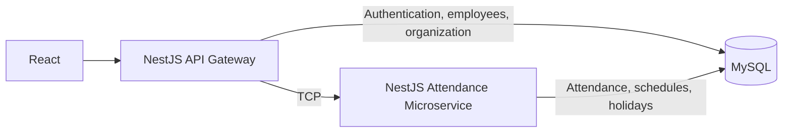
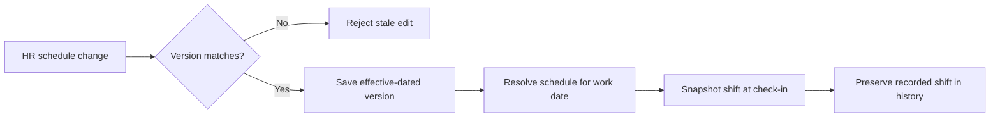
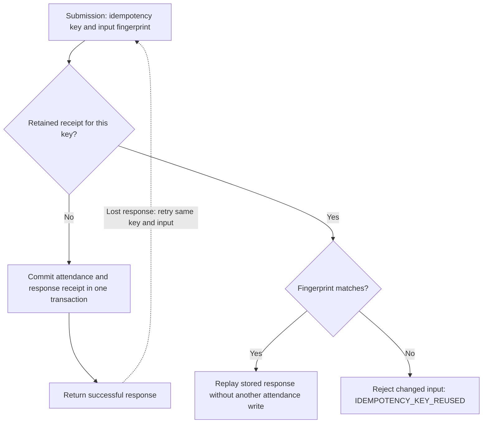
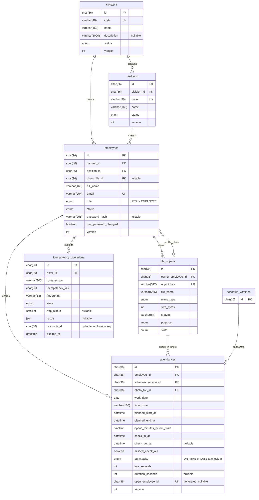
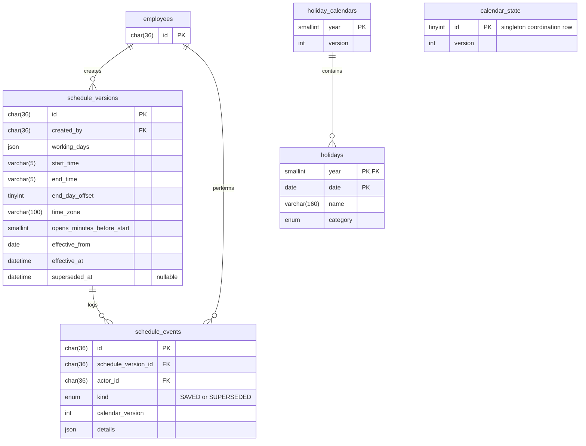

# WFH Attendance System

## Overview

A work-from-home attendance application where employees record photo-backed check-ins and check-outs, and HR manages work schedules, holidays, and attendance monitoring. This backend runs a NestJS HTTP gateway and a separate attendance microservice connected over TCP.

## Architecture



## Key Engineering Highlights

### 1. Photo-backed check-in and check-out events

Check-in and check-out include private photo evidence and use server time. HR controls how many minutes before the shift employees can check in. Check-outs before the planned end are marked early; later check-outs remain attached to the original shift until the next scheduled shift's check-in window opens, skipping holidays and non-working days.

At that cutoff, an unclosed record becomes a missed check-out without inventing a departure time or duration. When the employee checks in for the next eligible shift, marking the old record as missed and creating the new attendance happen in one transaction, so a failed check-in cannot leave a partial transition.

### 2. Timezone-aware work shifts

Shift times use IANA timezones and are resolved into UTC instants for comparison with server time. An overnight shift, such as 20:00–04:00, keeps the work date on which it starts, including check-outs after midnight. Working days and holidays determine shift eligibility in the configured timezone.

### 3. Versioned work schedules

HR changes create effective-dated schedule versions. Each save checks `expectedVersion` under a database lock and commits the new schedule and version together, so a stale HR edit receives a conflict instead of overwriting another change.

At check-in, attendance stores the schedule version, timezone, planned start/end, and early check-in allowance as a snapshot. Later schedule edits preserve these recorded shift values. The missed check-out cutoff is calculated from the next scheduled shift under the published calendar.



### 4. Idempotent attendance submissions

Each submission carries an idempotency key and a fingerprint of its input, including photo content. The attendance write and its successful response receipt commit in the same database transaction. If the response is lost, retrying the same key and input returns the stored result without creating another attendance record; reusing the key with changed input is rejected while the receipt is retained.



## Quick Start

For Linux production hosting, [compose.yaml](compose.yaml) runs the gateway, TCP attendance service, and MySQL 8.4 separately from any existing server MariaDB installation.

Requires Node.js **26.13.x**, npm **11.20.x**, and MySQL **8.4**. Create an empty database and a database user, with MySQL configured for UTC. Run these commands from `api-server/`:

```sh
npm ci
cp .env.example .env
mkdir -p ../.local/absensi-wfh/files
chmod 700 ../.local/absensi-wfh/files
```

Set the database credentials in `.env`, and replace `JWT_SECRET` and `ATTENDANCE_RPC_CREDENTIAL` with separate random secrets of at least 32 bytes. The commands above prepare the default `STORAGE_ROOT`; its parent directories must not be group- or world-writable.

```sh
npm run migration:run
npm run seed
```

Start the attendance microservice:

```sh
npm run start:attendance
```

In a second terminal, start the HTTP gateway:

```sh
npm run start:prod
```

The demo seed creates **4 HR accounts, 36 employees, and 6 divisions** in development or test environments:

| Role     | Email                          | Password              |
| -------- | ------------------------------ | --------------------- |
| HR       | `demo.hr01@example.test`       | `Demo-Password-12345` |
| Employee | `demo.employee01@example.test` | `Demo-Password-12345` |

Passwords require **8–128 Unicode characters**, including when changing your password.

Setting `SEED_PASSWORD` overrides the default password for newly seeded accounts. Re-running the seeder preserves existing accounts and passwords.

## Database Structure

The diagrams show all 11 application tables and their main columns, using database column names. Routine timestamps and some supporting columns are omitted for readability. `PK` means primary key, `FK` foreign key, and `UK` unique key; nullable columns are noted in comments. HR and employees share the `employees` table, distinguished by `role`.

### Accounts, attendance, files, and retry receipts



Database constraints enforce one attendance per `(employee_id, work_date)` and one open attendance per employee through the generated `open_employee_id`. A composite foreign key ensures an employee's position belongs to their division. Retry receipts are unique by `(actor_id, route_scope, idempotency_key)`. The idempotency table has one foreign key: `actor_id` references `employees.id`, identifying who submitted the operation. Its `resource_id` is an optional operation-specific reference without a foreign key, so there is no direct relationship to `attendances`. `file_objects` stores metadata; image bytes live in private filesystem storage.

### Versioned schedules and holidays



`calendar_state` coordinates calendar changes through a shared lock and version; it has no foreign key relationship to schedule rows. Holidays use the composite primary key `(year, date)`. Attendance references a schedule version and also copies its shift values, preserving the recorded shift after HR changes the schedule.

## Running integration tests

Use the pinned Node version (`nvm use`) and build before testing, since the operations suite launches the compiled entry points:

```sh
nvm use
npm run build
npm run test:integration
```

The command loads `.env.test.local`. Set `NODE_ENV=test`, use an empty dedicated database whose name ends in `_test`, and supply the database credentials and JWT/RPC secrets. Do not seed this database. The suite starts its own gateway and attendance processes.

MySQL must default to UTC (`@@session.time_zone = '+00:00'`). Configure `default-time-zone = '+00:00'` under `[mysqld]` in your MySQL configuration and restart MySQL. For the current server, an administrator can run `SET GLOBAL time_zone = '+00:00';`; this applies to new connections until restart.
